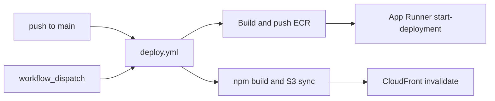

# Deploy automation (planned)

Replace the manual Docker → ECR and `npm build` → S3 → CloudFront checklist with a GitHub Actions workflow. This doc is the implementation sketch; the workflow itself is not in the repo yet.

## Goals

- Deploy backend and frontend on merge to `main` (path-filtered) without local Docker/AWS CLI steps
- Allow on-demand deploys via `workflow_dispatch` (backend, frontend, or both)
- Authenticate to AWS with **OIDC** (no long-lived access keys in GitHub secrets)

## Current manual process (what we are replacing)

**Backend:** build image → tag for ECR → `docker login` → push `:latest` → (today) rely on App Runner to pick up the image.

**Frontend:** `npm run build` in `frontend/` → `aws s3 sync dist … --delete` → CloudFront invalidation for `/*`. Vite rewrites hashed assets and `index.html` on each build; CI should build in the runner rather than committing `dist/` for production.

## Target architecture

## Proposed workflow

Add [`.github/workflows/deploy.yml`](../.github/workflows/deploy.yml) with two jobs that can run in parallel.

### Triggers

| Trigger | Behavior |
|---------|----------|
| `push` to `main` | Deploy backend if `backend/**` changed; frontend if `frontend/**` changed |
| `workflow_dispatch` | Choose `backend` / `frontend` / `both` |

### `deploy-backend`

1. Checkout
2. Configure AWS credentials via OIDC (`aws-actions/configure-aws-credentials`)
3. Login to ECR
4. `docker build -f backend/Dockerfile` from `./backend`
5. Push `:latest` and a `${{ github.sha }}` tag (sha tag helps rollback)
6. `aws apprunner start-deployment` so a new revision always runs (do not rely only on overwriting `:latest`)

### `deploy-frontend`

1. Checkout, Node 20, `npm ci` in `frontend/`
2. `npm run build`
3. Sync `dist/` to the web bucket (`--delete`)
4. Create a CloudFront invalidation for `/*`

## One-time AWS / GitHub setup

Do this once before enabling the workflow. Store real IDs in GitHub **variables** / **secrets**, not in committed docs.

1. Ensure the GitHub OIDC provider exists in the AWS account.
2. Create an IAM role trusted for this repo’s `main` ref (and optionally a GitHub Environment).
3. Grant that role least privilege for:
   - ECR push to the API repository
   - App Runner `StartDeployment` on the API service
   - S3 sync on the web bucket
   - CloudFront `CreateInvalidation` on the web distribution
4. In the GitHub repo settings, set at least:
   - `AWS_ROLE_ARN` (role to assume)
   - `APP_RUNNER_SERVICE_ARN` (API service)
   - Optionally variables for ECR repository URI, S3 bucket name, CloudFront distribution ID (or hardcode non-secret names in the workflow once they are stable)

## Out of scope (for the first cut)

- Terraform / recreating App Runner, S3, or CloudFront
- Committing or un-committing `frontend/dist` (optional follow-up: gitignore `dist` so local builds do not dirty PRs)
- Changing how goose migrations run inside the API container

## Acceptance checks

- [ ] Merge (or dispatch) deploys API; App Runner shows a new deployment
- [ ] Merge (or dispatch) updates the static site; invalidation completes
- [ ] Path-only backend or frontend change skips the other job
- [ ] No AWS access keys stored as GitHub secrets for deploy
